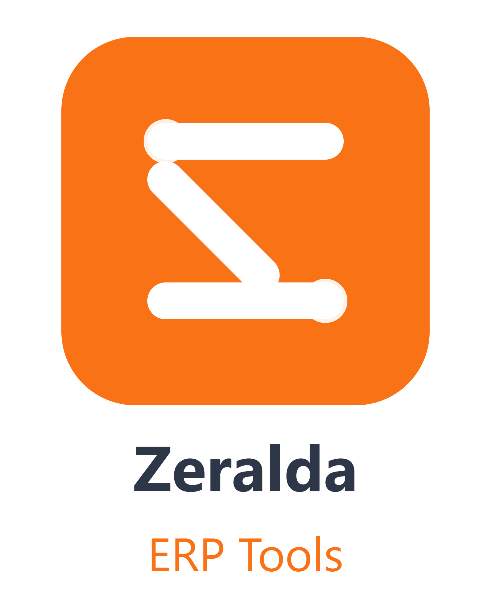

<div align="center">



# Zeralda ERP

### نظام إدارة الموارد المؤسسية المتكامل

**Comprehensive Enterprise Resource Planning System**

[]()
[]()
[]()
[]()
[]()

**نظام ERP جزائري متكامل** — 9 وحدات، 3 لغات، حماية متعددة الطبقات، تثبيت بنقرة واحدة

[التثبيت](#-التثبيت) · [البدء السريع](#-البدء-السريع) · [الوحدات](#-الوحدات) · [الأمان](#-نظام-الحماية) · [الدعم](#-الدعم-الفني)

</div>

---

## نظرة عامة

**Zeralda ERP** هو نظام إدارة موارد مؤسسية (ERP) مصمم خصيصاً للشركات الجزائرية والمغاربية. يجمع بين قوة البنية المؤسسية وسهولة الاستخدام، مع دعم كامل للغة العربية (RTL) والإنجليزية والفرنسية.

### لماذا Zeralda ERP؟

| الميزة | الوصف |
|--------|-------|
| **9 وحدات متكاملة** | CRM، مبيعات، مشتريات، مخزون، مالية، موارد بشرية، خدمات، استشارات، تقارير |
| **تثبيت بنقرة واحدة** | مُثبّت Windows أصلي مع Python مُضمّن — لا حاجة لأي متطلبات مسبقة |
| **حماية متعددة الطبقات** | نظام ترخيص بتوقيع RSA-PSS، تشفير AES-GCM، بصمة جهاز |
| **3 لغات** | عربية (RTL كامل)، إنجليزية، فرنسية |
| **ذكاء اصطناعي مدمج** | مساعد ذكي، تحليل فواتير OCR، بحث ويب |
| **تخزين مرن** | JSON محلي + PostgreSQL اختياري + IndexedDB للعميل |
| **مزامنة لحظية** | SSE (Server-Sent Events) لمزامنة البيانات بين المستخدمين |
| **نسخ احتياطي** | تلقائي + Google Drive + تصدير يدوي |

---

## التثبيت

### المتطلبات

- **Windows 10/11 (64-bit)** — لا حاجة لـ Python أو أي اعتماديات أخرى
- **2 جيجابايت RAM** (4 جيجابايت موصى بها)
- **1.5 جيجابايت مساحة حرة**
- **صلاحيات مسؤول** (للتثبيت فقط)

### التثبيت العادي

1. نزّل `Zeralda_ERP_Setup_v1.0.0.exe` من مجلد `installer/dist/`
2. شغّله كمسؤول (انقر يمين → تشغيل كمسؤول)
3. اتبع معالج التثبيت (يدعم العربية/الإنجليزية/الفرنسية)
4. اختر المكونات: **Core** (مطلوب) · **Tools** (Tesseract OCR) · **Demo** (بيانات تجريبية)
5. اختر الاختصارات: سطح المكتب · قائمة ابدأ · تشغيل تلقائي · قاعدة جدار الحماية
6. انتظر تثبيت اعتماديات Python (قد يستغرق عدة دقائق)
7. انقر "إنهاء" — سيتم تشغيل ERP تلقائياً

### التثبيت الصامت (للشركات)

```powershell
Zeralda_ERP_Setup_v1.0.0.exe /VERYSILENT /SUPPRESSMSGBOXES /NORESTART `
    /COMPONENTS="core,tools" /TASKS="desktopicon,firewall" `
    /DIR="C:\Program Files\Zeralda ERP" /LOG="install.log"
```

### إلغاء التثبيت

```powershell
"C:\Program Files\Zeralda ERP\unins000.exe" /VERYSILENT /SUPPRESSMSGBOXES
```

> سيُسألك المُثبّت ما إذا كنت تريد الإبقاء على بيانات المستخدم (قاعدة البيانات، السجلات).

---

## البدء السريع

### 1. تشغيل النظام

بعد التثبيت، استخدم أحد الخيارات:

- **اختصار سطح المكتب** — انقر مرتين على "Zeralda ERP"
- **قائمة ابدأ** → Zeralda ERP
- **التشغيل التلقائي** — يبدأ مع Windows (إذا اخترت ذلك)

النظام يعمل في **علبة النظام** (System Tray) — أيقونة برتقالية بجانب الساعة.

### 2. فتح لوحة التحكم

انقر يمين على أيقونة العلبة → **Open Dashboard**

أو افتح المتصفح يدوياً:
```
http://localhost:8080
```

### 3. تسجيل الدخول الافتراضي

| الحقل | القيمة |
|-------|--------|
| البريد الإلكتروني | `admin@zeralda.dz` |
| كلمة المرور | `Admin@2026!` |

> **أمان:** غيّر كلمة المرور فوراً من الإعدادات → الأمان

---

## الوحدات

| # | الوحدة | الوصف | الصفحة |
|---|--------|-------|--------|
| 1 | **CRM** | إدارة علاقات العملاء، الفرص، التفاعلات | `crm_management.html` |
| 2 | **Sales** | عروض الأسعار، الفواتير، الطلبيات | `sales_management.html` |
| 3 | **Purchasing** | طلبات الشراء، الموردين، استقبال البضائع | `purchasing_management.html` |
| 4 | **Inventory** | المنتجات، حركة المخزون، التنبيهات | `inventory_management.html` |
| 5 | **Finance** | دليل الحسابات، القيود المحاسبية، التقارير المالية | `finance_accounting.html` |
| 6 | **HR** | الموظفين، الحضور/الانصراف، الرواتب، الإجازات | `hr_management.html` |
| 7 | **Services** | طلبات الخدمة، جدولة المواعيد، تتبع الحالة | `services_management.html` |
| 8 | **Consulting** | المناقصات، المشاريع الاستشارية، العقود | `consulting_tenders_management.html` |
| 9 | **Reports** | تقارير المبيعات/المخزون، التحليلات المالية | `reports_analytics.html` |

---

## بنية المشروع

```
zeralda-erp-employees-main/
├── app/                        # FastAPI application (السيرفر الحديث)
│   ├── app.py                  # FastAPI app factory
│   ├── main.py                 # Entry point (uvicorn)
│   ├── handlers/               # API routes (auth, store, ai, ocr)
│   └── services/               # Business logic (storage, security, pdf)
├── backend/                    # Legacy Python services (auth, AI, OCR, keygen)
├── modules/                    # 9 وحدات HTML/JS
│   ├── crm/  sales/  purchasing/  inventory/
│   ├── finance/  hr/  services/  consulting/  reports/
├── shared/                     # مكتبات JS مشتركة
│   ├── layout_shell.js         # الهيكل والتنقل
│   ├── app_sync.js             # المزامنة مع السيرفر (SSE)
│   ├── zeralda_db.js           # IndexedDB layer
├── styles/                     # CSS (ثيمات فاتح/داكن)
├── launcher/                   # مشغّل سطح المكتب (tray + WebView2)
├── installer/                  # مُثبّت Inno Setup
│   ├── Zeralda_ERP_Setup.iss   # مصدر المُثبّت
│   ├── scripts/                # bootstrap.ps1 + uninstall_cleanup.ps1
│   ├── assets/                 # صور المعالج
│   └── dist/                   # المُثبّت المُجمّع (.exe)
├── tools/                      # Tesseract OCR + Python 3.11 embedded
├── database/                   # مخططات PostgreSQL
├── server.py                   # خادم HTTP القديم (fallback)
├── requirements.txt            # اعتماديات Python
├── .env.example                # قالب الإعدادات
├── LICENSE.txt                 # اتفاقية الترخيص
├── VERSION                     # رقم الإصدار
└── README.md                   # هذا الملف
```

---

## التطوير

### المتطلبات

- Python 3.11+
- Node.js (اختياري، للتحقق من JS)

### تشغيل بيئة التطوير

```powershell
# 1. استنساخ المستودع
git clone <repo-url>
cd zeralda-erp-employees-main

# 2. إنشاء بيئة افتراضية
python -m venv .venv
.\.venv\Scripts\Activate.ps1

# 3. تثبيت الاعتماديات
pip install -r requirements.txt

# 4. إعداد البيئة
cp .env.example .env
# عدّل .env: ضع SECRET_KEY و JWT_SECRET قويين

# 5. تشغيل السيرفر
$env:ENVIRONMENT="development"
$env:AUTH_DISABLED_IN_DEV="true"
python -m app.main
```

### بناء المُثبّت

```powershell
# تثبيت Inno Setup 6.2+
winget install JRSoftware.InnoSetup

# تجميع المُثبّت
iscc.exe installer\Zeralda_ERP_Setup.iss
# النتيجة: installer\dist\Zeralda_ERP_Setup_v1.0.0.exe
```

### توقيع الكود (للإنتاج)

```powershell
signtool sign /fd SHA256 /tr http://timestamp.digicert.com /td SHA256 `
    /f mycert.pfx /p <password> `
    installer\dist\Zeralda_ERP_Setup_v1.0.0.exe
```

---

## التخزين

ثلاث طبقات تخزين مرنة:

| الطبقة | الأولوية | السرعة | الاستخدام |
|--------|---------|--------|-----------|
| **IndexedDB** | 1 (العميل) | فورية | بيانات العميل، الإعدادات، الكاش |
| **JSON Server** | 2 (السيرفر) | سريعة | بيانات مشتركة، تاريخ، undo/redo |
| **PostgreSQL** | 3 (اختياري) | متوسطة | إنتاج متعدد المستخدمين، ACID |

- **التطوير:** IndexedDB + JSON
- **الإنتاج:** IndexedDB + PostgreSQL + JSON backup

---

## الذكاء الاصطناعي

| الخدمة | الحالة | الوصف |
|--------|--------|-------|
| **AI Chat** | متاح | مساعد ذكي (Hugging Face) |
| **Web Search** | متاح | بحث DuckDuckGo مدمج |
| **OCR + AI** | متاح | استخراج نصوص من الصور/PDF |
| **Invoice Analysis** | متاح | تحليل فواتير واستخراج حقول |

الإعداد من `Settings → AI Assistant` أو `.env`:
```env
HUGGINGFACE_API_KEY=your-key
HUGGINGFACE_MODEL=mistralai/Mistral-7B-Instruct-v0.2
```

---

## اختصارات لوحة المفاتيح

| الاختصار | الوظيفة |
|----------|---------|
| `Ctrl+S` | حفظ |
| `Escape` | إغلاق النوافذ |
| `Ctrl+Shift+M` | قائمة الوحدات |
| `F12` | أدوات المطور |

---

## الدعم الفني

### استكشاف الأخطاء

| المشكلة | الحل |
|---------|------|
| النظام لا يعمل | شغّل `launcher\Launch_ERP.cmd` كمسؤول |
| المنفذ 8080 مشغول | أوقف العملية: `launcher\ForceStop_Server.cmd` |
| البيانات لا تُحفظ | تحقق من Console (F12) → localStorage |

### التواصل

- **المطوّر:** Zitouni Abdelhakim
- **البريد:** saddamzeralda@gmail.com
- **الهاتف:** 0696409083

---

## الترخيص

ملكية خاصة — © 2024-2026 Zitouni Abdelhakim. جميع الحقوق محفوظة.
راجع [LICENSE.txt](LICENSE.txt) للتفاصيل الكاملة.

---

<div align="center">

**Zeralda ERP** v1.0.0 — صُنع في الجزائر

[التثبيت](#-التثبيت) · [البدء السريع](#-البدء-السريع) · [الوحدات](#-الوحدات) · [الأمان](#-نظام-الحماية) · [الدعم](#-الدعم-الفني)

</div>
